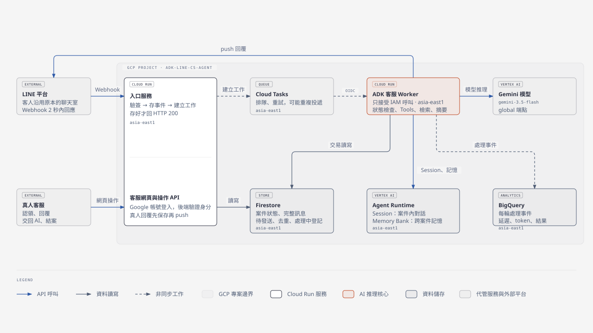
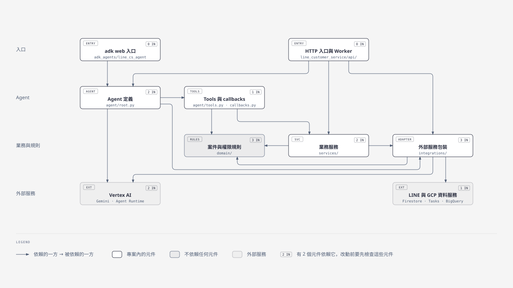

# LINE AI 客服 Agent

用 Google ADK 與 Gemini 建置的 LINE 電商客服 Agent，設計目標是部署在 Cloud Run、串接 LINE 官方帳號，並在需要時把案件轉交真人客服。會員、訂單與條款全部是合成資料。

這份 README 與 `docs/diagrams/` 描述設計與操作方式。

## 展示的能力

| 能力 | 行為 |
|---|---|
| 多輪對話與記憶 | 同一案件能延續，服務重啟後能還原；新案件依權限取得必要的跨案件記憶；控制送進模型的 Context 長度 |
| 安全與真人轉接 | 偵測到轉接條件後停止一般 AI 回覆；轉接前已在生成的舊回覆不能送出 |
| 商業規則與條款檢索 | 由可信身分與訂單權限決定可用政策；一般會員與 VVIP 得到不同權益 |
| Tools 行動能力 | 查詢訂單、取得會員權益、觸發轉接；業務函式與 ADK 包裝分離，之後的 MCP 可以共用 |

## 展示劇本

1. 一般會員查自己的 `ORD-123`：依一般條款回答退貨運費自付 60 元。
2. VVIP 查自己的 `ORD-999`：套用免運政策，回覆專屬政策後轉交真人。
3. 一般會員查 VVIP 的訂單：拒絕揭露資料。訂單編號不能證明身分。

客人的身分只看 Session 的 `user_id`，模型無法指定。合成身分 `cust-general-001` 是一般會員，`cust-vvip-001` 是 VVIP，定義在 [src/line_customer_service/services/customer_service.py](src/line_customer_service/services/customer_service.py)。接上 LINE 之後，身分由一份 LINE 使用者 ID 對照表決定，不在表上的帳號不能查訂單。

## 架構



- LINE 的 Webhook 要在 2 秒內回應，所以入口服務只做驗簽、保存事件、建立工作，推理交給 Worker。
- Worker 只接受 Cloud Tasks 帶身分的呼叫。它呼叫 Gemini、讀寫 Session 與 Memory Bank，回覆前再檢查一次案件狀態。每個案件一次只讓一個 Worker 處理；回覆用 push 並帶重試鍵，重試不會重複傳送。
- 案件狀態、真人認領、完整訊息、待發送紀錄集中在 Firestore；訂單、身分、權益不進任何一層記憶，每次都由 Tools 重新查詢。
- Gemini 走 global 端點；其餘服務都在 asia-east1。

可互動檢視的版本：[docs/diagrams/system-architecture.html](docs/diagrams/system-architecture.html)。訊息處理時序、記憶分層、Agent 處理流程、條款更新與客服狀態機見 [docs/diagrams/customer-service-flows.html](docs/diagrams/customer-service-flows.html)。

## 元件相依



箭頭由依賴的一方指向被依賴的一方。節點右上角的數字是有幾個元件依賴它，改動之前要先檢查那些元件。`domain/` 不依賴任何元件，規則可以單獨測試。

## 目錄結構

```text
adk_agents/line_cs_agent/      adk web 的入口，只匯入 Agent
src/line_customer_service/
  agent/                       Agent 定義與 ADK Function Tools
  services/                    訂單、會員、權益查詢
  domain/                      客服案件狀態機
  api/                         FastAPI 入口
  integrations/line/           LINE 簽章驗證
  integrations/vertex_ai/      Agent Runtime 的查詢與建立
scripts/                       連線檢查與雲端資源建立
tests/unit/                    單元測試，不需要網路
tests/agent/                   Agent 情境測試，會呼叫 Gemini
docs/                          架構圖與流程圖
```

## 安裝與執行

需要的工具：

- Python 3.12
- [uv](https://docs.astral.sh/uv/)，用來安裝 `uv.lock` 鎖定的套件版本
- Google Cloud CLI，並且已經執行過 `gcloud auth application-default login`，讓本機程式能用你的帳號呼叫 Vertex AI
- 一個已啟用 Vertex AI API 的 GCP 專案

步驟：

1. 安裝套件。

   ```powershell
   uv sync
   ```

2. 把 `.env.example` 複製成 `.env`，填入自己的 GCP 專案 ID。`.env` 不進版本控制。

   ```powershell
   Copy-Item .env.example .env
   ```

3. 確認憑證、專案、區域都能呼叫 Gemini。輸出的最後一段是 `回覆 'OK'` 就代表連線正常。

   ```powershell
   uv run python scripts/check_gemini.py
   ```

4. 啟動 ADK 的開發介面，在瀏覽器和 Agent 對話。

   ```powershell
   uv run adk web adk_agents
   ```

5. 要把對話保存在 Vertex AI，先建立 Agent Runtime，再把它印出的完整資源名稱帶進 `--session_service_uri`。

   ```powershell
   uv run python scripts/create_agent_runtime.py
   uv run adk web adk_agents --session_service_uri "agentengine://<Agent Runtime 完整資源名稱>"
   ```

   資源名稱要用 `projects/.../locations/asia-east1/reasoningEngines/...` 的完整寫法。只給最後的 ID 時，區域會改讀 `.env` 的 `global`，結果是查不到 Session 而且不報錯。

6. 啟動 HTTP 服務。`GET http://127.0.0.1:8081/healthz` 回傳 `{"status":"ok"}`。

   ```powershell
   uv run uvicorn line_customer_service.api.app:create_app --factory --port 8081
   ```

## 測試

測試分兩層，另有程式碼檢查。

1. 程式碼檢查。看到 `All checks passed!` 代表通過。

   ```powershell
   uv run ruff check
   ```

2. 單元測試，不需要網路。最後一行出現 `passed` 而且沒有 `failed` 代表通過。

   ```powershell
   uv run pytest
   ```

3. Agent 情境測試，用三個展示劇本實際呼叫 Gemini，需要 `.env` 與本機憑證，會產生少量 token 費用。它檢查工具呼叫、工具回傳與案件狀態，不比對模型的逐字回覆。

   ```powershell
   uv run pytest tests/agent
   ```

推送到 GitHub 後，[.github/workflows/ci.yml](.github/workflows/ci.yml) 會自動跑第 1、2 項。

## 維護與除錯

| 要做的事 | 位置 |
|---|---|
| 修改合成會員、訂單、退貨運費政策 | [src/line_customer_service/services/customer_service.py](src/line_customer_service/services/customer_service.py) 的 `SYNTHETIC_MEMBERS`、`SYNTHETIC_ORDERS`、`_RETURN_SHIPPING_POLICY` |
| 修改 Agent 的提示詞或模型 | [src/line_customer_service/agent/root.py](src/line_customer_service/agent/root.py) 的 `INSTRUCTION` 與 `MODEL` |
| 修改轉接規則與案件狀態 | [src/line_customer_service/domain/conversation.py](src/line_customer_service/domain/conversation.py) |
| 新增或修改 Tools | [src/line_customer_service/agent/tools.py](src/line_customer_service/agent/tools.py)，業務邏輯放在 `services/` |

改完之後先跑測試。

常見問題：

- Agent 呼叫模型失敗：先跑 `uv run python scripts/check_gemini.py`。這支腳本不經過 ADK，能分辨問題出在憑證、專案、區域，還是 Agent 本身。
- 重啟後找不到先前的對話：檢查 `--session_service_uri` 用的是完整資源名稱。
- Windows 上 import `_sqlite3`、`cygrpc` 這類原生元件失敗：檢查 Windows 安全性裡的智慧型應用程式控制，它會擋下沒有簽章的 Python 原生元件。

## 開發方式

這個專案用 Claude Code 協作開發。

- 架構選型、應用情境判斷、元件之間的相依關係由作者決定，每項決定先查證官方文件再定案。
- 程式、測試與文件由 Claude Code 依作者的決定實作，每次提交前經作者審閱。
- 雲端資源的建立、修改與部署由作者親手執行。
- 程式碼檢查、單元測試、Agent 情境測試自動執行，通過後才進下一項工作。

## 文件

| 文件 | 內容 |
|---|---|
| [docs/diagrams/system-architecture.html](docs/diagrams/system-architecture.html) | 系統架構圖 |
| [docs/diagrams/component-dependencies.html](docs/diagrams/component-dependencies.html) | 元件相依圖 |
| [docs/diagrams/customer-service-flows.html](docs/diagrams/customer-service-flows.html) | 訊息處理時序、記憶分層、Agent 處理流程、條款更新、客服狀態機 |
